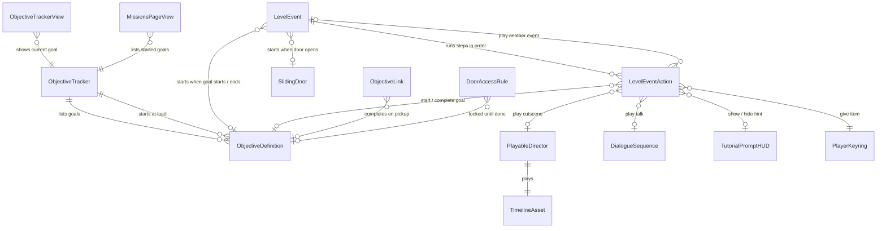

# Objectives & Cinematics — Easy Guide

Make story moments with **no code**. Walk into a box → cutscene plays → new goal shows on screen.

---

## 1. Big idea (30 seconds)

- An **Objective** is a goal. Like "Climb out of the crater".
- The **Objective Tracker** remembers each goal: *not started*, *active*, or *done*.
- A **Level Event** is a list of steps. Something starts it (walk into box, goal done, door opens). Then it runs steps top to bottom.
- The **HUD** (top-left) shows the newest active goal. The **Missions tab** lists all started goals.

```
 Player walks in box ──► Level Event ──► steps: lock player → play cutscene → talk → give item → start goal → unlock
                                                                                              │
                                                              HUD shows new goal ◄────────────┘
```

---

## 2. Words

| Word | Means |
|---|---|
| Objective | One goal. A file (asset). |
| Tracker | One per level. Holds the goal list and remembers state. |
| Level Event | A box or object that runs steps. |
| Step | One thing to do: talk, play cutscene, give item… |
| Timeline | Unity cutscene file (`.playable`). Moves things, plays sound, shows effects. |
| Director | The thing in the scene that plays a Timeline. |
| HUD tracker | Goal panel on screen, top-left. |

---

## 3. Which classes to use

You only touch the **bold** ones. The rest work by themselves.

| Class | What it does | Where |
|---|---|---|
| **ObjectiveDefinition** | A goal file: title + text. | `Assets/Game/Scripts/Objectives/ObjectiveSOs/` |
| **ObjectiveTracker** | One per level. Goal list, start list. | `[Gameplay]/ObjectiveTracker` |
| **LevelEvent** | Runs steps when its source fires. | Any object under `[Gameplay]` |
| LevelEventAction | A step. Pick from the **+** menu. | Inside a Level Event |
| **PlayableDirector** (Unity) | Plays your Timeline. | Next to your cutscene objects |
| **DialogueSequence** | Lines someone says. | `Assets/Game/Scripts/DialogueSystem/DialogueSOs/` |
| ObjectiveLink | Pickup/interact finishes a goal. | On the item |
| DoorAccessRule | Door stays locked until goal done / key held. | On a door |
| TutorialPromptHUD | Shows a key hint like "[Ctrl] Aim grapple". | Any scene object |
| ObjectiveTrackerView | HUD goal panel. Already in the player UI. | `New UI/Prefabs/New/Objective Tracker HUD.prefab` |
| MissionsPageView | Missions tab list. Already in the player UI. | `New UI/Prefabs/New/Missions Page.prefab` |
| PlayerKeyring | Items the player holds (Grapple Hook, Z Key). | On the player |

---

## 4. Class diagram (crow's foot)

How to read the line ends: `||` = exactly one, `o|` = zero or one, `|{` = one or many, `o{` = zero or many.



---

## 5. Recipe: cutscene + new goal (no code)

Goal: player walks into a room → screen shakes → cutscene → Crow talks → player gets an item → new goal shows.

1. **Make the goal.** Project window → right-click → *Create > JunkLite > Objectives > Objective Definition*. Set **Title** and **Body**.
2. **Add it to the level.** Select `[Gameplay]/ObjectiveTracker`. Drag the goal into **Objectives**.
3. **Make the talk.** Right-click → *Create > Dialogue > Sequence* (or copy one in `DialogueSOs`). Write the lines.
4. **Make the cutscene.**
   - Make an empty object, add **Playable Director**.
   - Open *Window > Sequencing > Timeline* and click **Create**.
   - Add tracks: **Activation** (show/hide objects), **Animation**, **Audio**.
   - On the Director set **Play On Awake = off** and **Wrap Mode = None**.
   - On each Activation track set **Post-playback state**: what it should be after the cutscene. For example, *Active* for "crater", *Inactive* for "old floor".
5. **Make the event.** Hierarchy → right-click → *JunkLite > Level Event*. You get a box under `[Gameplay]`. Move and resize the box where the player walks.
6. **Add steps** with **+** in the Level Event. A good order:
   1. *Player/Lock Player*
   2. *World/Camera Shake* (or put shake in the Timeline)
   3. *Story/Play Timeline* → drag your Director in
   4. *Story/Play Dialogue* → drag your Dialogue in
   5. *Player/Grant Item* → e.g. `Grapple Hook`
   6. *Objectives/Start Objective* → drag your goal in
   7. *UI/Show Hint* (optional)
   8. *Player/Unlock Player*
7. Tick **Wait Until Out Of Combat** so it never starts mid-fight.
8. **Finish the goal later.** Make a second Level Event box where the goal ends. Add the step *Objectives/Complete Objective* → drag the same goal in.
   - Want it to work only after the cutscene? Untick the box object (inactive). In the first event add the step *World/Set Active* to turn it on.
9. **Check.** *Tools > JunkLite > Level > Validate Level Events*. Fix every warning in the Console.
10. **Play.** Walk in. The HUD shows your goal top-left. The Missions tab lists it.

> Locks are safe. Player locks always come off when the event ends, if the player dies, or if the object is turned off.

---

## 6. Inspector cheat sheet

### Objective Definition (goal file)

| Field | Put here |
|---|---|
| Id | Leave empty. Uses the file name. |
| Title | Short goal, ALL CAPS. "CLIMB OUT OF THE CRATER" |
| Body | One line, how to do it. |
| Sort Order | Order in the Missions tab. Low number = top. |

### Objective Tracker (`[Gameplay]/ObjectiveTracker`, one per level)

| Field | Put here |
|---|---|
| Objectives | Every goal in this level. A goal not listed here will not show in Missions. |
| Primary | The main level goal. Shown when nothing else is active. |
| Start Active | Goals active at level start. The **last** one is shown first on the HUD. |

### Level Event

| Field | Put here |
|---|---|
| Source | What starts it. *Trigger Enter* (box), *Objective Started*, *Objective Completed*, *Door Opened*, *Level Start*, *Manual*. |
| Source Objective | Only for the Objective sources. Which goal. |
| Source Door | Only for *Door Opened*. Which door. |
| Play Once | On = runs one time only. |
| Wait Until Out Of Combat | On = waits until the fight ends. Use for cutscenes. |
| Actions | Steps. **+** to add, drag to reorder. A ⚠ means a field is empty. |
| Play Now / Abort | Buttons in Play Mode, for testing. |

### Steps (the **+** menu)

| Menu | What it does | Fields |
|---|---|---|
| Objectives/Start Objective | Goal becomes active. HUD shows it. | Objective |
| Objectives/Complete Objective | Goal done. HUD ticks it. | Objective |
| Story/Play Dialogue | Plays talk, waits until it ends. | Sequence |
| Story/Play Timeline | Plays a cutscene. | Director, Lock Player, Wait Until Done |
| Player/Lock Player | Player can't move or act. | Freeze Movement (off = input only, still falls) |
| Player/Unlock Player | Removes every lock this event took. | — |
| Player/Teleport Player | Moves player to a point. | Target |
| Player/Wait For Landing | Waits until the player lands. | Timeout, Fallback point |
| Player/Grant Item | Gives a keyring item. | Key Tag (`Grapple Hook`, `Z Key`…) |
| UI/Show Hint | Key hint on screen. | Prompt, Input Action (`Player/GrappleAim`), Label |
| UI/Hide Hint | Hides or ticks the hint. | Prompt, Mark Complete |
| World/Set Active | Turns objects on/off. | Targets, Active |
| World/Camera Shake | Shakes the screen. | Source (empty = player shake), Force |
| World/Switch Camera | Uses another Cinemachine camera (follows the player). Switch back to `PosZCam` later. | Camera |
| Flow/Wait | Waits some seconds. | Seconds |
| Flow/Play Level Event | Starts another event. | Target, Wait Until Done |
| Flow/Invoke UnityEvent | Calls any method. Escape hatch. | On Run |

### Other parts you may set

| Object | Field | Put here |
|---|---|---|
| Playable Director | Play On Awake | Off |
| Playable Director | Wrap Mode | **None** (end state stays) |
| Activation track | Post-playback state | Active / Inactive after the cutscene |
| Signal Receiver (on Director) | Reaction | Shake from Timeline: `CinemachineImpulseSource.GenerateImpulseWithForce` + force |
| Objective Link (on item) | Objective Based + Objective | The goal this pickup finishes |
| Door Access Rule (on door) | Required Objective / Key Tag | Door opens only after this |
| Tutorial Prompt HUD | — | Add to any object. Use it in Show/Hide Hint steps. |

### Menus and tools

| Menu | Does |
|---|---|
| *Create > JunkLite > Objectives > Objective Definition* | New goal file |
| *Create > Dialogue > Sequence* | New talk file |
| *GameObject > JunkLite > Level Event* | New event box under `[Gameplay]` |
| *Tools > JunkLite > Level > Validate Level Events* | Finds empty fields and missing goals |
| *Tools > JunkLite > UI > Build Objective HUD + Missions Prefabs* | Rebuilds missing HUD prefabs (does not overwrite) |

---

## 7. Common mistakes

| Problem | Fix |
|---|---|
| Event never starts | Box must be on the player's path. Source = Trigger Enter. Player object has tag `Player`. |
| Goal not in Missions tab | Add it to Tracker **Objectives**. |
| HUD shows nothing | No active goal. Add **Start Active** or a *Start Objective* step. The scene must use the Game Root / `New Player UI 2`. |
| Cutscene objects flip back at the end | Director Wrap Mode = **None**. Set each Activation track's post-playback state. |
| Player stuck after cutscene | Add *Player/Unlock Player* at the end (locks also clear when the event ends). |
| Exit box fires too early | Keep it inactive. Turn it on with *World/Set Active* from the first event. |

---

## 8. Real example in the game

`Service Floor` → `[Gameplay]/Room8 Collapse`:

- **`Room8_Collapse`** box. Lock → play `Room8_Collapse.playable` (shake, explosion, debris, floor gone) → wait → unlock (she falls) → wait for landing → lock → Crow talk → give `Grapple Hook` → turn on exit box → start `ESCAPE_BASEMENT` → hint → unlock.
- **`Room8_BasementExit`** box. Complete `ESCAPE_BASEMENT` → tick hint.
- **`[Gameplay]/ZDoor_StartBruteObjective`**. Source *Door Opened* (Z Door) → start `DEFEAT_BRUTE`.

Open them in the Inspector and copy the pattern.

---

## 9. Need a new step type? (only code you will ever need)

```csharp
using System.Collections;
using UnityEngine;

namespace junklite
{
[System.Serializable, LevelEventActionMenu("World/Play Sound")]
public sealed class PlaySoundAction : LevelEventAction
{
    public AudioSource source;

    public override IEnumerator Run(LevelEvent context)
    {
        if (source != null) source.Play();
        yield break;   // or wait: while (source.isPlaying) yield return null;
    }

    public override string Summary => "Play sound";
}
}
```

Save the file. It shows up in the **+** menu by itself.
