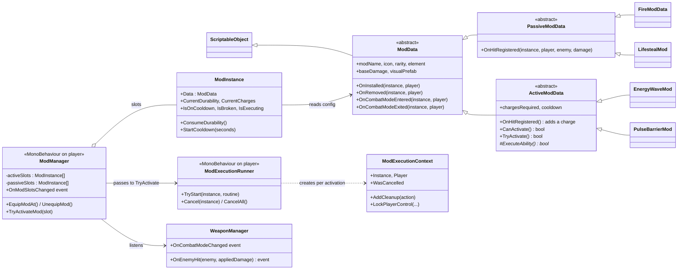

# JunkLite: programmer & game designer guide

Read this before working on JunkLite, with or without AI agents. It's the short version. Details live in:
- `MAIN_MECHANICS.md`: how the game plays.
- `ARCHITECTURE_HANDOFF.md`: code status and known gaps.
- `AGENTS.md`: the rules agents follow.

---

## 1. The game in 30 seconds

- **2.5D side-scroller.** 2D Spine characters in a full 3D world (URP), single-player, Unity 6.
- You move **left and right on a lane**. A lane is a straight line along world X or Z.
- **The world rotates.** At the end of a lane, a **Camera Switch Trigger** swings the camera 90°, puts you on a new lane, and the level continues. The reference is `Scenes/Level 1/V2/Rooftop Scene v2`.
- **Free-move rooms** (safe and explore rooms, e.g. Service Floor Room 0) lead into lane rooms through a door. You press **E to proceed**, which snaps you onto the lane.
- **Always armed.** There is no combat mode. Cassidy fights with her fists from the start and mods are always live. The **blades** are a permanent arm upgrade: press **E** on the pickup and the fists are replaced for good.

---

## 2. Working with AI agents

- Agents read `AGENTS.md` first. Keep rules there; `CLAUDE.md` and `GEMINI.md` just point to it.
- Agents edit scenes and assets through the **Unity CLI** connected to your open Editor. Setup is in `AGENTS.md`; check it with `unity status`.
- Agents ask before saving scenes. **Check the Editor before you approve a save.** Everything they do is undoable until then.
- When something changes how the game plays, update `MAIN_MECHANICS.md` (and `AGENTS.md` if it's a rule) in the same change.

---

## 3. Lanes & pathing (setting up a level)

**A lane path is not a spline.** It's a chain of straight segments. It only *places* characters on the lane; the player's controller does the moving.

### Set up a lane path
1. Under `[Gameplay]`, create an empty object, e.g. `LanePath_Room1-8`, at position 0, 0, 0.
2. Add the **Lane Path** component.
3. Add child empties `Point_0`, `Point_1`, … **The hierarchy order is the path order.**
4. Neighbouring points may differ in **X only or Z only**. Height (Y) is ignored. The line drawn in the Scene view is **cyan** when the segment is valid and **red** when it isn't axis-aligned.
5. The line's depth (Z, or X after a turn) is where the player walks, so it must pass through every doorway.

### "E to proceed" entry
1. Under `[Gameplay]`, create an empty object and add a **Box Collider** and a **Lane Entry Trigger**.
2. Size the box to cover the area in front of the exit door.
3. Assign **Lane Path**, plus **Gate Door** (a `Door4_Sliding`, which stays locked until the player presses E).
4. Start the path just inside the trigger, so pressing E only shifts the player sideways.

### Free-move zones, locked doors, keys and objectives
- **Z movement zone:** add a Box Collider + **Z Movement Zone** under `[Gameplay]`. Inside it the player walks in depth. Add more Box Colliders on the same object for L-shaped rooms. Leave the room through a **Lane Entry Trigger** (E) to get back on the path. If the lane runs on another axis, set the trigger's **Lane Camera**.
- **Objectives:** create *JunkLite > Objectives > Objective Definition* assets and list them on `[Gameplay]/ObjectiveTracker` (set **Primary**). Each objective is Inactive → Active → Complete. Put the ones active from the start in **Start Active** (the last one listed is shown first on the HUD). The HUD tracker (top-left, `Objective Tracker HUD.prefab`) shows the newest active objective and ticks it off when complete. The Missions tab (`Missions Page.prefab`) lists every started objective; unstarted ones stay hidden.
- **Step-by-step guide:** `OBJECTIVES_AND_CINEMATICS_GUIDE.md` (plain-language, Inspector cheat sheet, class diagram).
- **Level Events (story beats):** *GameObject > JunkLite > Level Event* (or add **Level Event** to any object). Pick a **Source** (Trigger Enter, Objective Started/Completed, Door Opened, Level Start, Manual) and add steps with **+**: start/complete objective, play dialogue, play Timeline, lock/unlock player, teleport, wait for landing, grant item (e.g. Grapple Hook), show/hide hint, set active, camera shake, wait, play another event, UnityEvent. Steps run top to bottom; locks are always released at the end, on death or if the object is disabled. Tick *Wait Until Out Of Combat* for cutscenes. Check setup with *Tools > JunkLite > Level > Validate Level Events*. Example: `[Gameplay]/Room8 Collapse/Room8_Collapse`.
- **"OBJECTIVE BASED" items:** add an **Objective Link**, tick *Objective Based* and pick the objective. `HealPickUp` (with *Requires Interact*), `KeyPickup`, `ServiceElevator` and `ObjectiveOnDeath` (enemies) complete it. A completed item stays silent.
- **Locked doors:** add a **Door Access Rule** to a `Door4_Sliding`: a required objective, a required key tag, or *Locked Forever*, plus an optional locked dialogue.
- **Objective lines:** an Objective Link's *Completed Dialogue* plays once when it completes (it waits if another dialogue is running).
- **Starting a fight:** an **Encounter Start Trigger** box starts its referenced `EncounterController` when the player walks in.
- **Keys:** a **Key Pickup** uses its GameObject's **tag** as the key id (add the tag in Tags & Layers). The player's `PlayerKeyring` keeps keys for the run.

### Corners (world rotation)
1. Add a point at the corner and a point along the new direction.
2. Place a `CameraSwitchTrigger` prefab at the corner. Put its **A** point on the old line and its **B** point on the new line.
3. Set the rotations and cameras from this table:

| Direction | Rotation | Camera |
| --- | --- | --- |
| +X | 0 | PosZCam |
| +Z | −90 | NegXCam |
| −X | −180 | NegZCam |
| −Z | −270 | PosXCam |

### Enemies
Full checklist for making and placing enemies: `ENEMIES.md`. Place them roughly on the lane, then run **Tools > JunkLite > Level > Snap All Enemies To Lane Path**. Each enemy snaps to the closest of the scene's lane paths. An enemy's facing (Y rotation) decides its lane. Keep enemies out of free-move rooms.

### Limits
- **No curves.** Build a spiral staircase as straight flights with a 90° corner at each landing.
- Use one path per continuous lane.

---

## 4. Level building rules

- **Few colliders, kept separate from art (for performance).**
  - All level collision lives under the **`Colliders`** root: a handful of big boxes.
  - `Colliders/Floors` has one strip per lane section that follows the path, one flat square per free-move room, and ramps.
  - `Colliders/Walls` has room perimeters and lane ends.
  - Art meshes have **no colliders**, except door prefabs. Never use mesh colliders.
  - When you extend a lane, stretch or add a floor strip.
- **Hierarchy:**
  - `[Gameplay]` holds the spawn point, lane paths, entry triggers and camera switch triggers.
  - `[Environment]/Shared` holds pieces that span several rooms.
  - Everything else goes in `[Environment]/Room N/<Category>`. The categories are Ceiling, Doors, Dressing, Floors, Foreground, Gameplay, Lighting, Props, Structure and Walls.
- **Doors** between rooms use `Prefabs/Environment/Doors/Door4_Sliding`. It opens when the player is close, and its blocker collider switches off once it's open. Lane doors use Y rotation 270 and scale 2.87.
- **Spawn point** rotation must match the first lane.
- **Walk the whole lane in Play mode** before saving a level.

---

### Tutorial prompts and dissolving props
- **Tutorial prompts** use `TutorialPromptHUD` (created at runtime by `Level0SequenceManager`). Call `Show(new TutorialPromptHUD.Entry("Player/Jump", "Jump"))`, then `Complete()` once the player has done it. Key labels switch between keyboard and gamepad on their own. Pass `keyboardOverride`/`gamepadOverride` for composite actions like Move.
- **Props that dissolve in** need a `DissolveController` (with its Renderer assigned) and a `ProximityDissolveIn` on the renderer object, using a Dissolve-shader material (e.g. `SimProp_Dissolve.mat`). They start hidden and reveal once when the player comes within `radius`.

### Player prefab: new Cass vs old player
- **Switch players** on the **Player Lifecycle** component of `Game Root` / `Game Manager` (prefabs under `Prefabs/Manager/`): tick **Use New Player** for `Player_Cass`, untick it to playtest with the old `Player_2.2`. It applies on the next spawn after a scene load.
- **Cass never flips by scale.** She has two skeletons, `Cass_R` (facing right) and `Cass_L` (facing left), under `BODY SPINE`; the **Spine Animation Controller** swaps them. Both need the same animation names and the `RightHand` bone (the weapon hand).
- **Anything with a left/right offset** on the new player needs a **Facing Mirror**: author it for facing right. Tick **Turn On Y** for VFX groups so their particles and children mirror too. Code must read `Character2D5Controller.IsFacingRight` / `FacingSign`, never `localScale.x`.
- **Weapon draw order:** **Player Armament > Weapon Sorting Order Facing Left** puts the held visual behind the body when the right hand is the far arm. The blades visual is the authored, inactive `Blades Visual` child of `Weaponsocket`; `PlayerArmament` only toggles it.

## 5. Dev tools

| Tool | Where | Use |
| --- | --- | --- |
| **Dev Console** (in-game) | Starts hidden each Play session, even with saved access enabled. **F10** enables/opens or hides it (Editor only). Explicitly enabling **JunkLite > Dev Tools > Enable In-Game Panel** or the pause-menu switch during play opens it. Status window: **JunkLite > Dev Tools Console**. | Player tab: infinite mod durability, heal, invincible, unlock mod slots, +1 upgrade point, reset upgrades, clear inventory, defeat, respawn. Spawn tab: enemies, mods; Grant Blades / Revert To Fists. Mods tab and Run tab (run control). Disabling tools hides their UI and clears overrides; F10 remains available. |
| **Performance overlay** | Starts hidden; **F9** in Play mode shows/hides it. | FPS, frame time, and a spike graph. Spikes are logged to CSV (**Tools > JunkLite > Performance > Open Frame Spike Logs**). |
| **Level tools** | **Tools > JunkLite > Level** | Snap Selected / Snap All Enemies To Lane Path; Replace Mesh Colliders With Boxes; Remove Mesh Colliders. Each is one Undo step. |
| **Validators** | **Tools > JunkLite > Systems > Validate**, **Validate Enemies**, **Validate Encounters** | Check scene setup: Game Root, cameras, enemies, encounters. |
| **Performance helpers** | **Tools > JunkLite > Performance** | Optimize audio imports; enable world texture streaming. |
| **Font rebuild** | **JunkLite > UI > Rebuild New UI Font Assets** | Run it when TMP glyphs are missing. |
| **Tests** | `Assets/Game/Tests/Editor` (Test Runner, EditMode) | Run after touching damage, locks, or lifecycle code. |

⚠️ **Tools > JunkLite > Systems > Rebuild** rewrites the V2.5 scene. Only run it on purpose.

**Investigating stutters:** reproduce with F10 and movement, then open the latest frame-spike CSV after leaving Play Mode. The `frame` column identifies the preceding completed gameplay frame. New captures include the last F10 command, its duration and age in frames, GC collection time, synchronous audio/asset loading, and logger disk I/O. `-1` means a counter is unavailable. `delayed_*` CPU/GPU timings arrive several frames late and are context only; they do not identify the cause of that row's hitch. Allocation volume alone does not prove a collection. Subsystem timings can overlap (physics includes trigger callbacks); compare candidates with the Unity Profiler timeline. Severe consecutive hitches (100 ms+) bypass the normal log cooldown.

The console resolves its spawn prefabs when it is created. Infinite mod durability still updates equipped and stored mods each frame. Level startup prepares the combat music and initializes DOTween so first contact does not pay those initialization costs. These changes require no Inspector wiring.

---

## 6. ScriptableObjects: config, never state

**ScriptableObjects (SOs) are read-only design data.** Designers edit them in the Inspector; code reads them.
- **Never store runtime state on an SO** (current HP, cooldown timers, charges, durability left). SOs are shared assets, so state written to one leaks between instances and into the next play session in the Editor.
- Runtime state lives on an **instance** created from the SO:
  - `ModData` → `ModInstance` (a plain C# object per slot)
  - `WeaponData` → the player's `PlayerArmament` holds the current one; combo/cooldown state lives in `WeaponManager`'s `CombatState`

| Create menu (right-click > Create) | Asset | What it configures |
| --- | --- | --- |
| Junklite/Mods/… (Fire, Electric, Lifesteal, Pogo, Energy Wave, Pulse Barrier, Phantom Strike, Social Distance, Dont Blink) | `ModData` subclasses | Mod name, icon, rarity, element, damage, charges, cooldown, VFX prefab |
| Junklite/Melee Weapon Data | `WeaponData` | Arm weapon stats and combos (Fist, Sword). Acquired permanently through a `WeaponUpgradePickup`; no durability |
| Junklite/Character Stats | `CharacterStats` | Player base stats (e.g. `Player Stats.asset`) |
| Junklite/Progression/Upgrade Tree | `UpgradeTreeConfig` | The whole upgrade tree: branches, nodes, costs, prerequisites, effects (`Resources/UpgradeTreeConfig.asset`) |
| Junklite/Progression/Player Progression | `PlayerProgressionConfig` | XP table and level-up presentation (`Resources/PlayerProgressionConfig.asset`) |
| JunkLite/Enemy Config | `EnemyConfig` | Enemy tuning per archetype |
| Junklite/Combat/Status Effect | `StatusEffectDefinition` | Burn, shock, and similar effects |
| Junklite/Drop Table | `DropTable` | Loot drops |
| Junklite/Audio/Player Sound Profile, Enemy Sound Profile, Audio Library | Audio SOs | Sound sets |
| Dialogue/Sequence | `DialogueSequence` | Dialogue lines. Set each line's **Speaker** and **Mood** |
| Dialogue/Speaker | `DialogueSpeaker` | Name, role tag, side (left NPC / right Cassidy), accent colour, and a portrait per mood (Calm, Shout, Angry, Profile). Cassidy and Crow live in `Scripts/DialogueSystem/Speakers/` |
| JunkLite/UI Font Catalog | `UIFontCatalog` | The three approved fonts (don't duplicate it) |

---

## 7. Mod system

### Damage numbers

Enemy damage numbers use the applied hit's damage type: **physical = pale white, fire = orange, electric = blue, magic = violet**. A burning enemy can still show white physical hits; only its fire damage ticks are orange. Larger hits grow without changing element color. Damage-over-time ticks use smaller upright numbers, while direct hits use bold slanted Play digits, a short pop, a readable hold and a smooth upward fade.

Tune the existing **Damage Popup Manager** component's **Damage Type Colors** and **Damage Typography & Motion**: digit height (relative to a 1080p viewport), tick scale, medium/high damage thresholds, horizontal travel and hit separation. **Popup Behavior** still controls speed and lifetime. Numbers face the rendering camera and adjust their size through zooms, within world-size limits. XP keeps its progression-profile color and sizing. No new scene or prefab wiring is required.

### Pulse Barrier visuals

Pulse Barrier uses cyan segmented arcs with two tilted energy orbits around Cassidy. The effect stays centered on the visible Spine body through animation, facing flips and lane turns. Absorbed hits send a bright pulse through the arcs, low shield health flickers, shield depletion scatters sparks, and timed expiry contracts the effect. Cancellation and player disable/death remove it immediately. Its existing 100 shield HP, 10-second duration and cooldown settings are unchanged.

Tune **Pulse Barrier Visual Profile** under `Assets/Game/VFX/Pulse Barrier/`: Color, Radius Scale (relative to half the player collider's height), Ribbon Width, Orbit Speed, Opacity, Activation Duration, Break Duration and Expiry Duration. The `Pulse Arc Visuals` reference on the current mod replaces its legacy activation/loop/absorb prefabs. No Inspector wiring is required. If the assets are missing, run **Tools > JunkLite > VFX > Install Pulse Barrier Arcs**. The effect reuses one GPU-animated mesh, follows the player's Spine orientation through camera turns, and keeps gameplay shield behavior separate from presentation.

### Enemy fire visuals

Fire hits already apply a timed Burn through the status system. Enemies automatically receive a `StatusEffectVisuals` presenter at runtime: a bright orange animated heat layer follows the sprite/Spine body, small amber embers drift outward and upward from across the body, and successful burn damage ticks pulse the heat. Refreshing burn reuses the same visuals; expiry, death and disable clean them up. Larger flame tongues are optional and disabled in the default profile.

Tune the shared **Burn Visual Profile** in `Assets/Game/Resources/`: Heat Color/Strength, Tick Pulse Strength/Duration, Ember Color/Opacity/Size and Show Embers. Flame Opacity and Show Flames control the optional larger flames independently. Flame Scale scales both flames and embers; **Flame Max Width To Height** limits their spread from wide attack poses or transparent sprite padding. This profile is visual configuration only and does not change burn damage or duration. The two materials and small noise texture live in `Assets/Game/VFX/Burn/`. If these assets are missing, run **Tools > JunkLite > VFX > Install Burn Visual Assets**.

No scene wiring is needed. For unusual enemies, add **Status Effect Visuals** to the enemy root before Play mode and assign **Visual Root** or **Body Renderers** explicitly. Automatic discovery supports ordinary SpriteRenderers and Spine SkeletonRenderers; custom mesh bodies can be assigned explicitly. **Flame Anchor** is optional: its origin is the flame base, local X is width, local Y is upward, and its local XY plane should match the body. Without an anchor, the largest body renderer supplies placement and size. **Flame Scale** is a per-enemy multiplier.

The heat layer leaves the character's materials and damage flash intact. The presenter stops and clears the legacy burn child at initialization and keeps it disabled, including when the presenter is disabled or removed; poison/electric/bleed effects are unchanged. The additional cost is one heat draw per body submesh and one combined flame/ember draw per burning enemy. Twenty small embers animate on the GPU without a ParticleSystem simulation. Disable both Show Flames and Show Embers for a cheaper heat-only setting; check the target encounter on the target hardware before increasing overlap or adding smoke/distortion.

Grunt's **Grunt Brain > Stun > Stun VFX Object** is intentionally empty. Its old **Debuff (1)** child produced a separate smoke aura on every hit-stun, overlapping fire visuals. Leave that reference empty to keep the aura disabled; hit-stun still works.

### Grunt group tactics

Grunts run **Grunt Brain** (a Melee Chaser Brain with group policy on top). If a Grunt prefab or scene grunt still shows **Melee Chaser Brain**, run **Tools > JunkLite > Enemies > Migrate Grunt Prefab To GruntBrain** (or **Migrate Selected To GruntBrain** for scene objects). Values and scene overrides are kept. The full design is in `GRUNT_BEHAVIOR_PLAN.md`.

What they do now:
- **Two modes.** While you run, grunts chase in single file and match the speed of the grunt ahead. Once you plant your feet, attack or parry, they spread out and start the tricks below. A yellow/red cube above a selected grunt in the Scene view shows Pursue/Engage.
- **No shoving.** A grunt never walks into the grunt ahead or backs into the one behind. It slows down and keeps a gap instead. Collision stays on, so they can never overlap.
- **Ally hit flinch.** When you hit a grunt, the ones behind it flinch back one after another, stay back while your combo lasts, then creep back in.
- **Hold & pace.** A grunt waiting for its turn follows its slot as you move and shuffles around it instead of freezing. The front grunt without the attack turn occasionally feints a step in.
- **Vault.** The second grunt on your side hops over the line to your open side when it is close enough, then attacks from there. Attacks then alternate left and right. It only vaults while you are planted, re-aims at you during the crouch and in the air, and calls it off if you run, roll or jump. Hitting a grunt during its crouch cancels the vault; it has no i-frames in the air.
- **Pressure.** Hit the front grunt twice in 2.5 s and it backs off; a third hit with an ally behind it makes it hop out of the line so the next one steps up.
- **Mood.** A pack that is being hit hangs back and stops feinting. A pack that has not been hit for 3 s crowds in and attacks faster.
- **Patrol and fidget.** Every grunt patrols 3 units either side of where it was placed (**Patrol Distance** on its Grunt Brain, Patrol group; set 0 on a placed grunt to make it a standing guard). It walks the lane, pauses at each end and sometimes stops to look back. It reverses at walls, at other grunts and at ledges. Guards left at 0 occasionally turn to look the other way.
- **Noticing.** A grunt only sees you in front of it; from behind you have to get within **Rear Radius** (2 u) of its Detection Zone. A patrolling grunt breaks straight into a run when it sees you; a standing guard first faces you for a short beat. Either way, idle grunts near it wake up one after another. Hitting a grunt always wakes it. When it loses you it walks to where it last saw you, looks both ways, then goes back to patrol.
- **Bodies.** You walk through grunts and they can never push you. Grunts also walk through each other, dummies and any enemy that is not holding its place in the fight (stunned, knocked down, idle, patrolling), so nothing ever gets stuck behind a dummy or a broken grunt. Grunts that are fighting together still keep their spacing and only one attacks at a time. The switch is **Pass Through Enemies** on the enemy's root component (Body header); it is on for grunts and dummies. Turning it on for another type works, but only grunts have spacing logic, so others may bunch up while crowding you.
- **Launch on any enemy.** **Can Be Launched** (Launch header on the enemy root) is the only switch a type needs to be thrown by heavy hits; it is on for grunts and hyenas. With it off, an enemy never leaves the ground (normal hits lose their upward push too). The enemy needs a normal falling body (a Rigidbody with gravity). **Validate Enemies** flags it otherwise.
- **Launch.** The sword's **Up attack** throws a grunt or hyena up (the third ground hit is a strong push, not a launch), horizontal in the air. It bounces once, lies down for a moment and gets up; hits in the air keep it up (three times at most), hits on the ground keep it down a little longer, and a hit while it rises knocks it back down. All of that shares one cap (**Downed Max Total**, 2 s); after it the get-up has armor, so a grunt can never be pinned forever. A grunt killed while flying or lying blends into its death clip instead of adding to it. A finisher that kills sends the body flying. Launched grunts fly through other enemies (Launch settings, **Pass Through Enemies**); the launch height is **Apex Height** there, in units (4 on the Grunt and Hyenas; the hit's upward knockback is ignored unless it is 0), the float at the top is **Apex Hang Speed** / **Apex Hang Gravity Scale**, the flight speed is **Gravity Scale**, and the bounce has its own **Bounce Restitution** and **Bounce Gravity Scale**. The Brute cannot be launched. The sword's air combo is three hits (Attack_1, Attack_2, then the air kick); the third is a **Spike**: on a launched grunt it knocks it sideways (knockback x) and drives it down (knockback y as a downward speed) under **Spike Gravity Scale**, then the grunt skids along the floor on landing (**Spike Skid Keep**, 1.5 by default, up to 2) instead of bouncing; on a grounded enemy it is a normal hit pushed sideways. Set **Reaction Kind** on any combo step of a Melee Weapon Data asset to Launch (with Override Knockback on; knockback x is the horizontal speed, y the upward speed).

Tuning (all on **Grunt Brain**, per prefab or per scene instance):

| Group | Field | Default | Effect |
| --- | --- | --- | --- |
| Pursue / Engage | Planted Speed | 1.5 | Your lane speed at or below which you count as standing to fight. |
| Pursue / Engage | Engage Delay / Pursue Delay | 0.35 s / 0.2 s | How long you must stand / keep moving before the pack switches. |
| Lane Spacing | Contact Gap / Spacing Gain | 0.05 / 6 | Smallest gap ever allowed; how late and hard followers brake. |
| Ally Hit Reaction | Ally Hit Reaction / Max Places Behind | on / 3 | Turn the flinch off, or limit how far down the line it travels. |
| Ally Hit Reaction | Ripple Delay | 0.08 s | Delay per place in line, so the flinch travels like a wave. |
| Ally Hit Reaction | Recoil Distance / Recoil Speed | 0.5 / 4.5 | Size and snap of the step back. |
| Ally Hit Reaction | Recoil Hold Range / Creep Speed | 0.35–0.6 s / 1.2 | How long they stay back after the last hit, and how slowly they return. |
| Hold & Pace | Pace Amplitude / Pace Toward Limit | 0.4 / 0.15 | How far they shuffle away from / toward you. |
| Hold & Pace | Pace Pause Range | 0.4–1.2 s | Rhythm between shuffles. |
| Hold & Pace | Queue Gap | 0.5 | Spacing behind the grunt in front. Lower it if lines feel too long. |
| Feint | Feint Chance | 0.25 | Per pause, front grunt only. 0 disables feints. |
| Vault | Vault Enabled / Vault Chance | on / 0.85 | Turn the vault off, or make it hesitate more. |
| Vault | Vault Max Start Distance | 4.5 | "Close enough" to vault. |
| Vault | Vault Max Far Side Count | 0 | 0 = only the second grunt ever vaults. 1 = four grunts can split 2/2. |
| Vault | Vault Height / Vault Speed / Vault Telegraph | 1.6 / 9 / 0.2 s | Arc shape and how long the crouch (punish window) lasts. |
| Vault | Leap Has I-Frames | off | On if players abuse hitting them mid-air. |
| Vault | Vault Abort Distance / Vault Max Correction Speed | 1.5 / 8 | How far you may move during the crouch before it is called off; how fast the landing follows you in the air. |
| Hit Pressure | Pressure Hits To Max / Pressure Window | 3 / 2.5 s | How many hits in how long count as "being hit a lot". |
| Hit Pressure | Back Off Pressure / Back Off Distance | 0.66 / 1.2 | When the front grunt gives ground, and how far. |
| Hit Pressure | Fall Back Cooldown | 6 s | How often the same grunt may hop out of the line. |
| Group Mood | Group Wary Pressure / Bold After Quiet Seconds | 0.5 / 3 s | When the pack gets cautious / bold. |
| Group Mood | Bold Handoff Delay | 0.1 s | Attack cadence while bold (normal is 0.25 s). |
| Variance | Chase Speed Variance / Rhythm Variance | 0.1 / 0.2 | Per-grunt randomness so a crowd does not move as one. |
| Patrol & Idle | Patrol End Pause Range / Patrol Look Back Chance | 0.8–2 s / 0.3 | Pause at each end of a leg; chance per leg to stop and look back. |
| Patrol & Idle | Idle Fidget / Fidget Interval / Fidget Chance | on / 3–6 s / 0.5 | Guards turning to look the other way. |
| Alert & Search | Alert Enabled / Alert Duration Range | on / 0.3–0.5 s | The beat on first sight. A hit skips it. |
| Alert & Search | Pack Alert Radius / Pack Alert Step | 6 / 0.12 s | How far the alarm travels and the delay per grunt. |
| Alert & Search | Search Enabled / Search Look Duration | on / 0.5 s | The look-around after losing you. |
| Body Ahead Probe | Probe Distance / Probe Interval | 1.5 / 0.1 s | How far ahead a grunt looks for bodies the director cannot see. |
| Blocked | Blocked After / Blocked Speed | 0.25 s / 0.3 | When a stuck grunt re-thinks and wakes the grunt in its way. |

On the **Detection Zone** child: **Use Facing Cone** and **Rear Radius** (grunt prefab: on, 2). On the **Grunt Enemy** root: **Can Be Launched** and the **Launch** settings (gravity, bounce, downed time, juggle cap, body tilt). On the **Enemy Spine Animation Controller**: **Measured Locomotion** with its start/stop speeds, and **Tilt Pivot Height** for the launch pose. On the player **Weapon Manager**: **Launch Hitstop Duration**.

Animation: the grunt skeleton has no Roll, Walk, Backstep, Alert, Knockdown or GetUp clip. Vaults use **Jump_Start / Float / Jump_End**, shuffling and patrolling use **Run** slowed down (**Min Locomotion Time Scale** on the Spine presenter), the alert beat uses **Idle**, and the launch holds the last frame of **Hurt** with the body tilted, then **Jump_End** for the get-up. If the animator adds clips, change the names on **Enemy Spine Animation Controller**; no code change is needed. Two slots are waiting for clips: **Walk Backward** (stepping back while facing the player: backing off, flinching, shuffling away) and **Walk Forward** (slow steps in while holding a slot). Leave them empty and the grunt uses the slowed Run clip as now; fill them in and the presenter picks the right one from the direction the grunt is actually moving. **Step Walk Reference Speed** is the speed at which those clips play at normal rate.

**Concepts**
- A **mod** is a ScriptableObject (`ModData`) plus a runtime `ModInstance` per equipped slot.
- **Passive mods** run automatically whenever they are installed (mods are always live; there is no combat mode), e.g. Fire, Electric, Lifesteal, Pogo.
- **Active mods** are triggered by their input. They build **charges** on hits and then go on **cooldown**, e.g. Energy Wave, Pulse Barrier, Phantom Strike.
- Each successful use consumes **durability**. A mod at 0 durability is **broken** and stops working.
- `ModManager` (on the player) owns the slots. Slots unlock over time (`UnlockActiveSlot` / `UnlockPassiveSlot`).
- Long abilities (dashes, channels) run through the player's `ModExecutionRunner`. It gives each activation a `ModExecutionContext` that owns cleanup and input, movement and immunity locks, so cancelling, dying, or disabling the player always cleans up.

**Flow**
1. `ModManager` enables every installed, unbroken mod when it is enabled (`OnCombatModeEntered`) and disables them when it is disabled (`OnCombatModeExited`). The hook names are historical; they mean enabled/disabled.
2. A hit lands, and `WeaponManager.OnEnemyHit` fires with the **actually applied** damage. Every equipped mod gets `OnHitRegistered`: passives react, and actives gain a charge.
3. The mod input calls `ModManager.TryActivateMod(slot)`, which runs `ActiveModData.TryActivate`:
   - It checks `CanActivate` (not running, not on cooldown, enough charges).
   - It calls `ExecuteAbility`.
   - If the ability was used, it starts the cooldown, and `ModManager` consumes durability.
4. A long ability calls `executionRunner.TryStart(instance, ctx => Routine(ctx))`. Inside, it takes locks via `ctx.LockPlayerControl(...)` and registers `ctx.AddCleanup(...)`. Both are released automatically on finish, cancel, removal, disable, or death.

**Making a new mod**
1. Create a class deriving from `PassiveModData` or `ActiveModData` and give it `[CreateAssetMenu(menuName = "Junklite/Mods/Your Mod")]`.
2. Override the hooks you need. For an active mod, implement `ExecuteAbility`, and don't call `StartCooldown` yourself.
3. Put any per-use state on the `ModInstance` or inside the execution routine, **never on the SO**.
4. Create the asset, fill in name, icon, damage, charges and cooldown, then spawn it with the **Dev Console > Spawn > Mods** tab to test.

**Lifecycle rule:** `OnInstalled` / `OnRemoved` mean the mod is in a slot. `OnCombatModeEntered` / `OnCombatModeExited` mean it's currently usable. Don't mix them up.

---

## 8. Upgrades (the skill tree)

**How it plays.** Every level-up grants one upgrade point (`UpgradeTreeConfig.pointsPerLevel`); bosses (`EnemyBase > Upgrade Point Reward`), `UpgradePointPickup` objects and the *Progression/Grant Upgrade Points* level-event step grant more, once per profile. Points are spent in the **UPGRADES** tab of the I menu. Dash and double jump are always on for the demo (not tree nodes); a short opening note explains this. Blades nodes stay greyed out until the blades pickup has been taken.

**Data.** One asset, `Assets/Game/Resources/UpgradeTreeConfig.asset` (create it with **Tools > JunkLite > Progression > Install Upgrade Tree**; **Reset Upgrade Tree To Defaults** restores the shipped nodes). Each node has an **Id** (stable; written to the save), name, description, icon, **Branch** (column), **Tier** (row), **Cost**, **Prerequisite Ids**, an optional **Required Weapon**, and **Effects**:

| Effect kind | Fields used | What it changes |
| --- | --- | --- |
| Stat Bonus | Stat, Flat, Percent | `PlayerRuntimeStats.Evaluate`: (base + Σflat) × (1 + Σ% / 100). Stats: Max Health, Damage, Armor, Move Speed, Jump Force, Double Jump Force, Dash Cooldown (negative % shortens it), Attack Speed, Finisher Force |
| Unlock Ability | Ability | Dash Strike (dashing damages enemies; each enemy hit spawns **Hit Slash Prefab** on `PlayerDashStrike` on the enemy: `Prefabs/Effects/Dash Strike Slash.prefab`, which wraps the Free Slash VFX pack's *Slash Eletric VFX* (child tilted -15° on X so the arc reads as a horizontal sweep from the side camera, shifted 0.4 to centre it). The pack ships with Play On Awake off, so `PlayerDashStrike` plays every particle system on spawn. Swap the child for the Fire/Water/Earth version for another element; tune **Hit Slash Scale / Rotation Offset / Tilt (0 = horizontal) / Lifetime** on the component. An optional **Strike Trail** `TrailRenderer` emits while dashing with the node owned). Dash and Double Jump are not nodes; they are always on |
| Mod Slot | Slot Kind | +1 active or passive mod slot on top of the player prefab's starting slots |

**Build switches** (on the tree asset): **Starting Points** is the grant every profile has on top of level and bonus points (0 for the demo: upgrades are earned in play or granted with the dev tools' **+1 / +5 UPGRADE POINTS**; it is not saved, so changing it updates existing saves). **Tools > JunkLite > Progression > Reset Saved Progress** (or the dev tools' **RESET PROGRESS**) wipes XP, points, purchases and weapons. **Max Available Tier** caps what can be bought: 0 (shipped) = the whole tree, bought in prerequisite order; 1 = only the first node of each branch, everything above shows *Currently Unavailable*. **Reset Upgrade Tree To Defaults** replaces the nodes but keeps both switches.

**Adding a node:** add an entry to the tree asset, give it an id and a tier above its prerequisite, pick effects, save. No code. **Adding a new stat or ability:** add the enum value in `UpgradeTypes.cs`, then give it exactly one consumer in `PlayerCharacter.ApplyUpgrades` (movement/combat) or in the component that owns the mechanic. Never read the tree asset from gameplay code; read `PlayerRuntimeStats` / `PlayerUpgrades`.

**Runtime.** `PlayerUpgrades` (Game Root) owns points, purchases, owned weapons and collected sources and saves them in `player-progression.json` with the XP. `PlayerRuntimeStats` combines level-table bonuses (shipped empty) and upgrade bonuses; `PlayerCharacter.ApplyUpgrades` pushes the result into the controller, `WeaponManager` (attack speed, finisher force) and `PlayerDashStrike`. `ModManager.ApplyUnlockedSlots` adds bought slots to the prefab's starting counts.

**Icons.** Node cards are hexagons showing the upgrade's icon; the name is only in the details card. Icons are white-on-transparent PNGs in `Assets/Game/New UI/Icons/Upgrades/`, one per node id (`dash.strike.png`), plus `hex-fill`, `hex-frame` and `hex-frame-bold` for the cards. Anything dropped in that folder imports as a UI sprite automatically; **Tools > JunkLite > Progression > Assign Upgrade Icons** puts each sprite on its node (Install Upgrade Tree does it too). The shipped set is generated from vector shapes by `Tools/UpgradeIcons/make-upgrade-icons.js` (run `node Tools/UpgradeIcons/make-upgrade-icons.js .` from the repo root; `icon-sheet.js` renders a preview sheet), so it can be edited and regenerated; replacing a PNG with hand-drawn art is fine, keep it white on transparent and square. After changing the hexagon sprites run **Rebuild Upgrades Page Prefab**.

**UI.** `Upgrades Page.prefab` is authored once with **Tools > JunkLite > UI > Build Upgrades Page Prefab** and then edited in the Inspector like any prefab; `UpgradesPageView` only copies the inactive node template into the branch columns and binds text/state objects. Fonts: ZuumeEdge titles, Satoshi body.

## 9. Core code rules

- **Damage has one path.**
  - Build a `DamageRequest`, send it to an `IDamageReceiver`, and react only to a successful `DamageResult` (its *applied* amount).
  - Hit VFX, hit-stop, lifesteal and durability all key off the result.
  - Deduplicate targets in area and piercing attacks.
- **Player and enemies don't share a base class.**
  - `PlayerCharacter` owns its own input, parry, death and respawn.
  - Enemies derive from `EnemyBase`, with AI composed per type.
- **Weapons.** `PlayerArmament` owns the one current weapon (fists → blades, permanent) and its held visual; `WeaponManager` owns combat. UI listens to `PlayerArmament.WeaponChanged`. A character with its own animations for a weapon gets a copy of the asset (same **Weapon Id**) in its **Upgrade Path**; pickups still reference the shared asset.
- **Managers.**
  - The persistent **Game Root** holds GameManager, PlayerLifecycle, GameUIManager, input, the combat tracker and UI.
  - Each scene has a scene-local `CameraManager` and Level Context.
  - Get the player from `PlayerLifecycle.PlayerSpawned`, not through `GameManager`.
- **Locks are leases.** Input, movement and immunity locks are taken and released through disposable scopes. Never set or clear them by hand.
- **UI.** Use TextMeshPro UGUI with only three fonts: Play (in-world), ZuumeEdge (HUD titles) and Satoshi (HUD body). Apply them with the `UIFonts.Apply…` helpers.
- **Post effects at runtime** must use a Volume priority above **998** (Cinemachine's volumes); `CombatModeScreenGlitch` uses 10000.
- **Don't:**
  - add service locators, global event buses, or a universal character base class;
  - put runtime state on ScriptableObjects;
  - hand-write `.meta` files;
  - add mesh colliders.
