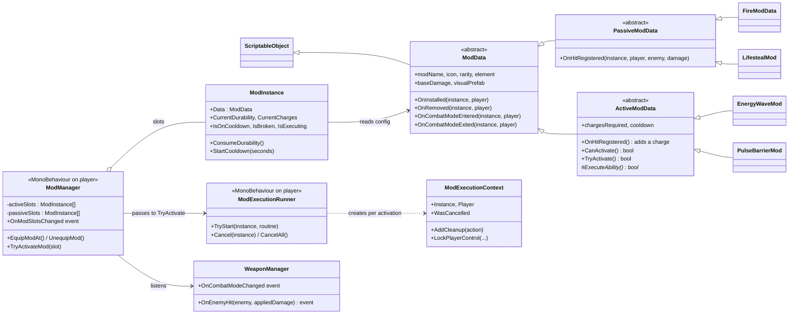

# JunkLite: programmer & game designer guide

Read this before working on JunkLite, with or without AI agents. It's the short version. Details live in:
- `MAIN_MECHANICS.md`: how the game plays.
- `ARCHITECTURE_HANDOFF.md`: code status and known gaps.
- `AGENTS.md`: the rules agents follow.

---

## 1. The game in 30 seconds

- **2.5D side-scroller.** 2D Spine characters in a full 3D world (URP), single-player, Unity 6.
- You move **left and right on a lane**. A lane is a straight line along world X or Z.
- **The world rotates.** At the end of a lane, a **Camera Switch Trigger** swings the camera 90°, puts you on a new lane, and the level continues. The reference is `Scenes/Level 1/V2/Rooftop Scene v2`.
- **Free-move rooms** (safe and explore rooms, e.g. Service Floor Room 0) lead into lane rooms through a door. You press **E to proceed**, which snaps you onto the lane.
- **Combat / mod mode.** **Q** or a left-stick click toggles it. It needs a weapon. Weapons show and mods become active.

---

## 2. Working with AI agents

- Agents read `AGENTS.md` first. Keep rules there; `CLAUDE.md` and `GEMINI.md` just point to it.
- Agents edit scenes and assets through the **Unity CLI** connected to your open Editor. Setup is in `AGENTS.md`; check it with `unity status`.
- Agents ask before saving scenes. **Check the Editor before you approve a save.** Everything they do is undoable until then.
- When something changes how the game plays, update `MAIN_MECHANICS.md` (and `AGENTS.md` if it's a rule) in the same change.

---

## 3. Lanes & pathing (setting up a level)

**A lane path is not a spline.** It's a chain of straight segments. It only *places* characters on the lane; the player's controller does the moving.

### Set up a lane path
1. Under `[Gameplay]`, create an empty object, e.g. `LanePath_Room1-8`, at position 0, 0, 0.
2. Add the **Lane Path** component.
3. Add child empties `Point_0`, `Point_1`, … **The hierarchy order is the path order.**
4. Neighbouring points may differ in **X only or Z only**. Height (Y) is ignored. The line drawn in the Scene view is **cyan** when the segment is valid and **red** when it isn't axis-aligned.
5. The line's depth (Z, or X after a turn) is where the player walks, so it must pass through every doorway.

### "E to proceed" entry
1. Under `[Gameplay]`, create an empty object and add a **Box Collider** and a **Lane Entry Trigger**.
2. Size the box to cover the area in front of the exit door.
3. Assign **Lane Path**, plus **Gate Door** (a `Door4_Sliding`, which stays locked until the player presses E).
4. Start the path just inside the trigger, so pressing E only shifts the player sideways.

### Free-move zones, locked doors, keys and objectives
- **Z movement zone:** add a Box Collider + **Z Movement Zone** under `[Gameplay]`. Inside it the player walks in depth. Add more Box Colliders on the same object for L-shaped rooms. Leave the room through a **Lane Entry Trigger** (E) to get back on the path. If the lane runs on another axis, set the trigger's **Lane Camera**.
- **Objectives:** create *JunkLite > Objectives > Objective Definition* assets and list them on `[Gameplay]/ObjectiveTracker` (set **Primary**). They show in the inventory's Missions tab.
- **"OBJECTIVE BASED" items:** add an **Objective Link**, tick *Objective Based* and pick the objective. `HealPickUp` (with *Requires Interact*), `KeyPickup`, `ServiceElevator` and `ObjectiveOnDeath` (enemies) complete it. A completed item stays silent.
- **Locked doors:** add a **Door Access Rule** to a `Door4_Sliding`: a required objective, a required key tag, or *Locked Forever*, plus an optional locked dialogue.
- **Objective lines:** an Objective Link's *Completed Dialogue* plays once when it completes (it waits if another dialogue is running).
- **Starting a fight:** an **Encounter Start Trigger** box starts its referenced `EncounterController` when the player walks in.
- **Keys:** a **Key Pickup** uses its GameObject's **tag** as the key id (add the tag in Tags & Layers). The player's `PlayerKeyring` keeps keys for the run.

### Corners (world rotation)
1. Add a point at the corner and a point along the new direction.
2. Place a `CameraSwitchTrigger` prefab at the corner. Put its **A** point on the old line and its **B** point on the new line.
3. Set the rotations and cameras from this table:

| Direction | Rotation | Camera |
| --- | --- | --- |
| +X | 0 | PosZCam |
| +Z | −90 | NegXCam |
| −X | −180 | NegZCam |
| −Z | −270 | PosXCam |

### Enemies
Place them roughly on the lane, then run **Tools > JunkLite > Level > Snap All Enemies To Lane Path**. Each enemy snaps to the closest of the scene's lane paths. An enemy's facing (Y rotation) decides its lane. Keep enemies out of free-move rooms.

### Limits
- **No curves.** Build a spiral staircase as straight flights with a 90° corner at each landing.
- Use one path per continuous lane.

---

## 4. Level building rules

- **Few colliders, kept separate from art (for performance).**
  - All level collision lives under the **`Colliders`** root: a handful of big boxes.
  - `Colliders/Floors` has one strip per lane section that follows the path, one flat square per free-move room, and ramps.
  - `Colliders/Walls` has room perimeters and lane ends.
  - Art meshes have **no colliders**, except door prefabs. Never use mesh colliders.
  - When you extend a lane, stretch or add a floor strip.
- **Hierarchy:**
  - `[Gameplay]` holds the spawn point, lane paths, entry triggers and camera switch triggers.
  - `[Environment]/Shared` holds pieces that span several rooms.
  - Everything else goes in `[Environment]/Room N/<Category>`. The categories are Ceiling, Doors, Dressing, Floors, Foreground, Gameplay, Lighting, Props, Structure and Walls.
- **Doors** between rooms use `Prefabs/Environment/Doors/Door4_Sliding`. It opens when the player is close, and its blocker collider switches off once it's open. Lane doors use Y rotation 270 and scale 2.87.
- **Spawn point** rotation must match the first lane.
- **Walk the whole lane in Play mode** before saving a level.

---

### Tutorial prompts and dissolving props
- **Tutorial prompts** use `TutorialPromptHUD` (created at runtime by `Level0SequenceManager`). Call `Show(new TutorialPromptHUD.Entry("Player/Jump", "Jump"))`, then `Complete()` once the player has done it. Key labels switch between keyboard and gamepad on their own. Pass `keyboardOverride`/`gamepadOverride` for composite actions like Move.
- **Props that dissolve in** need a `DissolveController` (with its Renderer assigned) and a `ProximityDissolveIn` on the renderer object, using a Dissolve-shader material (e.g. `SimProp_Dissolve.mat`). They start hidden and reveal once when the player comes within `radius`.

## 5. Dev tools

| Tool | Where | Use |
| --- | --- | --- |
| **Dev Console** (in-game) | **F10** in Play mode (Editor only). Enable it with **JunkLite > Dev Tools > Enable In-Game Panel**. Status window: **JunkLite > Dev Tools Console**. | Player tab: infinite ammo and durability, heal, invincible, unlock mod slots, clear inventory, defeat, respawn. Spawn tab: enemies, weapons, mods. Mods tab and Run tab (run control). |
| **Performance overlay** | **F9** in Play mode | FPS, frame time, and a spike graph. Spikes are logged to CSV (**Tools > JunkLite > Performance > Open Frame Spike Logs**). |
| **Level tools** | **Tools > JunkLite > Level** | Snap Selected / Snap All Enemies To Lane Path; Replace Mesh Colliders With Boxes; Remove Mesh Colliders. Each is one Undo step. |
| **Validators** | **Tools > JunkLite > Systems > Validate**, **Validate Enemies**, **Validate Encounters** | Check scene setup: Game Root, cameras, enemies, encounters. |
| **Performance helpers** | **Tools > JunkLite > Performance** | Optimize audio imports; enable world texture streaming. |
| **Font rebuild** | **JunkLite > UI > Rebuild New UI Font Assets** | Run it when TMP glyphs are missing. |
| **Tests** | `Assets/Game/Tests/Editor` (Test Runner, EditMode) | Run after touching damage, locks, or lifecycle code. |

⚠️ **Tools > JunkLite > Systems > Rebuild** rewrites the V2.5 scene. Only run it on purpose.

**Investigating stutters:** reproduce with F10 and movement, then open the latest frame-spike CSV after leaving Play Mode. The `frame` column identifies the preceding completed gameplay frame. New captures include the last F10 command, its duration and age in frames, GC collection time, synchronous audio/asset loading, and logger disk I/O. `-1` means a counter is unavailable. `delayed_*` CPU/GPU timings arrive several frames late and are context only; they do not identify the cause of that row's hitch. Allocation volume alone does not prove a collection. Subsystem timings can overlap (physics includes trigger callbacks); compare candidates with the Unity Profiler timeline. Severe consecutive hitches (100 ms+) bypass the normal log cooldown.

The console resolves its spawn prefabs when it is created. Infinite ammo/durability still updates equipped items each frame, but world-weapon discovery runs four times per second and immediately after commands/toggles. Level startup prepares the combat music and initializes DOTween so first contact does not pay those initialization costs. These changes require no Inspector wiring.

---

## 6. ScriptableObjects: config, never state

**ScriptableObjects (SOs) are read-only design data.** Designers edit them in the Inspector; code reads them.
- **Never store runtime state on an SO** (current HP, cooldown timers, charges, durability left). SOs are shared assets, so state written to one leaks between instances and into the next play session in the Editor.
- Runtime state lives on an **instance** created from the SO:
  - `ModData` → `ModInstance` (a plain C# object per slot)
  - `WeaponData` → `WeaponInstance` (a component on the spawned weapon)

| Create menu (right-click > Create) | Asset | What it configures |
| --- | --- | --- |
| Junklite/Mods/… (Fire, Electric, Lifesteal, Pogo, Energy Wave, Pulse Barrier, Phantom Strike, Social Distance, Dont Blink) | `ModData` subclasses | Mod name, icon, rarity, element, damage, charges, cooldown, VFX prefab |
| Junklite/Melee Weapon Data, Junklite/Ranged Weapon Data | `WeaponData` | Weapon stats, combos, projectiles |
| Junklite/Character Stats | `CharacterStats` | Player base stats (e.g. `Player Stats.asset`) |
| JunkLite/Enemy Config | `EnemyConfig` | Enemy tuning per archetype |
| Junklite/Combat/Status Effect | `StatusEffectDefinition` | Burn, shock, and similar effects |
| Junklite/Drop Table | `DropTable` | Loot drops |
| Junklite/Audio/Player Sound Profile, Enemy Sound Profile, Audio Library | Audio SOs | Sound sets |
| Dialogue/Sequence | `DialogueSequence` | Dialogue lines. Set each line's **Speaker** and **Mood** |
| Dialogue/Speaker | `DialogueSpeaker` | Name, role tag, side (left NPC / right Cassidy), accent colour, and a portrait per mood (Calm, Shout, Angry, Profile). Cassidy and Crow live in `Scripts/DialogueSystem/Speakers/` |
| JunkLite/UI Font Catalog | `UIFontCatalog` | The three approved fonts (don't duplicate it) |

---

## 7. Mod system

### Damage numbers

Enemy damage numbers use the applied hit's damage type: **physical = pale white, fire = orange, electric = blue, magic = violet**. A burning enemy can still show white physical hits; only its fire damage ticks are orange. Larger hits grow without changing element color. Damage-over-time ticks use smaller upright numbers, while direct hits use bold slanted Play digits, a short pop, a readable hold and a smooth upward fade.

Tune the existing **Damage Popup Manager** component's **Damage Type Colors** and **Damage Typography & Motion**: digit height (relative to a 1080p viewport), tick scale, medium/high damage thresholds, horizontal travel and hit separation. **Popup Behavior** still controls speed and lifetime. Numbers face the rendering camera and adjust their size through zooms, within world-size limits. XP keeps its progression-profile color and sizing. No new scene or prefab wiring is required.

### Pulse Barrier visuals

Pulse Barrier uses cyan segmented arcs with two tilted energy orbits around Cassidy. The effect stays centered on the visible Spine body through animation, facing flips and lane turns. Absorbed hits send a bright pulse through the arcs, low shield health flickers, shield depletion scatters sparks, and timed expiry contracts the effect. Cancellation and player disable/death remove it immediately. Its existing 100 shield HP, 10-second duration and cooldown settings are unchanged.

Tune **Pulse Barrier Visual Profile** under `Assets/Game/VFX/Pulse Barrier/`: Color, Radius Scale (relative to half the player collider's height), Ribbon Width, Orbit Speed, Opacity, Activation Duration, Break Duration and Expiry Duration. The `Pulse Arc Visuals` reference on the current mod replaces its legacy activation/loop/absorb prefabs. No Inspector wiring is required. If the assets are missing, run **Tools > JunkLite > VFX > Install Pulse Barrier Arcs**. The effect reuses one GPU-animated mesh, follows the player's Spine orientation through camera turns, and keeps gameplay shield behavior separate from presentation.

### Enemy fire visuals

Fire hits already apply a timed Burn through the status system. Enemies automatically receive a `StatusEffectVisuals` presenter at runtime: a bright orange animated heat layer follows the sprite/Spine body, small amber embers drift outward and upward from across the body, and successful burn damage ticks pulse the heat. Refreshing burn reuses the same visuals; expiry, death and disable clean them up. Larger flame tongues are optional and disabled in the default profile.

Tune the shared **Burn Visual Profile** in `Assets/Game/Resources/`: Heat Color/Strength, Tick Pulse Strength/Duration, Ember Color/Opacity/Size and Show Embers. Flame Opacity and Show Flames control the optional larger flames independently. Flame Scale scales both flames and embers; **Flame Max Width To Height** limits their spread from wide attack poses or transparent sprite padding. This profile is visual configuration only and does not change burn damage or duration. The two materials and small noise texture live in `Assets/Game/VFX/Burn/`. If these assets are missing, run **Tools > JunkLite > VFX > Install Burn Visual Assets**.

No scene wiring is needed. For unusual enemies, add **Status Effect Visuals** to the enemy root before Play mode and assign **Visual Root** or **Body Renderers** explicitly. Automatic discovery supports ordinary SpriteRenderers and Spine SkeletonRenderers; custom mesh bodies can be assigned explicitly. **Flame Anchor** is optional: its origin is the flame base, local X is width, local Y is upward, and its local XY plane should match the body. Without an anchor, the largest body renderer supplies placement and size. **Flame Scale** is a per-enemy multiplier.

The heat layer leaves the character's materials and damage flash intact. The presenter stops and clears the legacy burn child at initialization and keeps it disabled, including when the presenter is disabled or removed; poison/electric/bleed effects are unchanged. The additional cost is one heat draw per body submesh and one combined flame/ember draw per burning enemy. Twenty small embers animate on the GPU without a ParticleSystem simulation. Disable both Show Flames and Show Embers for a cheaper heat-only setting; check the target encounter on the target hardware before increasing overlap or adding smoke/distortion.

Grunt's **Melee Chaser Brain > Stun > Stun VFX Object** is intentionally empty. Its old **Debuff (1)** child produced a separate smoke aura on every hit-stun, overlapping fire visuals. Leave that reference empty to keep the aura disabled; hit-stun still works.

**Concepts**
- A **mod** is a ScriptableObject (`ModData`) plus a runtime `ModInstance` per equipped slot.
- **Passive mods** run automatically while you're in mod (combat) mode, e.g. Fire, Electric, Lifesteal, Pogo.
- **Active mods** are triggered by their input. They build **charges** on hits and then go on **cooldown**, e.g. Energy Wave, Pulse Barrier, Phantom Strike.
- Each successful use consumes **durability**. A mod at 0 durability is **broken** and stops working.
- `ModManager` (on the player) owns the slots. Slots unlock over time (`UnlockActiveSlot` / `UnlockPassiveSlot`).
- Long abilities (dashes, channels) run through the player's `ModExecutionRunner`. It gives each activation a `ModExecutionContext` that owns cleanup and input, movement and immunity locks, so cancelling, dying, or leaving mod mode always cleans up.

**Flow**
1. The player toggles mod mode, and `WeaponManager.OnCombatModeChanged` fires. `ModManager` then calls `OnCombatModeEntered` or `OnCombatModeExited` on each equipped, unbroken mod.
2. A hit lands, and `WeaponManager.OnEnemyHit` fires with the **actually applied** damage. Every equipped mod gets `OnHitRegistered`: passives react, and actives gain a charge.
3. The mod input calls `ModManager.TryActivateMod(slot)`, which runs `ActiveModData.TryActivate`:
   - It checks `CanActivate` (not running, not on cooldown, enough charges).
   - It calls `ExecuteAbility`.
   - If the ability was used, it starts the cooldown, and `ModManager` consumes durability.
4. A long ability calls `executionRunner.TryStart(instance, ctx => Routine(ctx))`. Inside, it takes locks via `ctx.LockPlayerControl(...)` and registers `ctx.AddCleanup(...)`. Both are released automatically on finish, cancel, removal, mode exit, disable, or death.

**Making a new mod**
1. Create a class deriving from `PassiveModData` or `ActiveModData` and give it `[CreateAssetMenu(menuName = "Junklite/Mods/Your Mod")]`.
2. Override the hooks you need. For an active mod, implement `ExecuteAbility`, and don't call `StartCooldown` yourself.
3. Put any per-use state on the `ModInstance` or inside the execution routine, **never on the SO**.
4. Create the asset, fill in name, icon, damage, charges and cooldown, then spawn it with the **Dev Console > Spawn > Mods** tab to test.

**Lifecycle rule:** `OnInstalled` / `OnRemoved` mean the mod is in a slot. `OnCombatModeEntered` / `OnCombatModeExited` mean it's currently usable. Don't mix them up.

---

## 8. Core code rules

- **Damage has one path.**
  - Build a `DamageRequest`, send it to an `IDamageReceiver`, and react only to a successful `DamageResult` (its *applied* amount).
  - Hit VFX, hit-stop, lifesteal and durability all key off the result.
  - Deduplicate targets in area and piercing attacks.
- **Player and enemies don't share a base class.**
  - `PlayerCharacter` owns its own input, parry, death and respawn.
  - Enemies derive from `EnemyBase`, with AI composed per type.
- **Weapons.** UI listens to `PlayerWeaponLoadout`, which owns the slots. `WeaponManager` owns combat.
- **Managers.**
  - The persistent **Game Root** holds GameManager, PlayerLifecycle, GameUIManager, input, the combat tracker and UI.
  - Each scene has a scene-local `CameraManager` and Level Context.
  - Get the player from `PlayerLifecycle.PlayerSpawned`, not through `GameManager`.
- **Locks are leases.** Input, movement and immunity locks are taken and released through disposable scopes. Never set or clear them by hand.
- **UI.** Use TextMeshPro UGUI with only three fonts: Play (in-world), ZuumeEdge (HUD titles) and Satoshi (HUD body). Apply them with the `UIFonts.Apply…` helpers.
- **Post effects at runtime** must use a Volume priority above **998** (Cinemachine's volumes); `CombatModeScreenGlitch` uses 10000.
- **Don't:**
  - add service locators, global event buses, or a universal character base class;
  - put runtime state on ScriptableObjects;
  - hand-write `.meta` files;
  - add mesh colliders.
